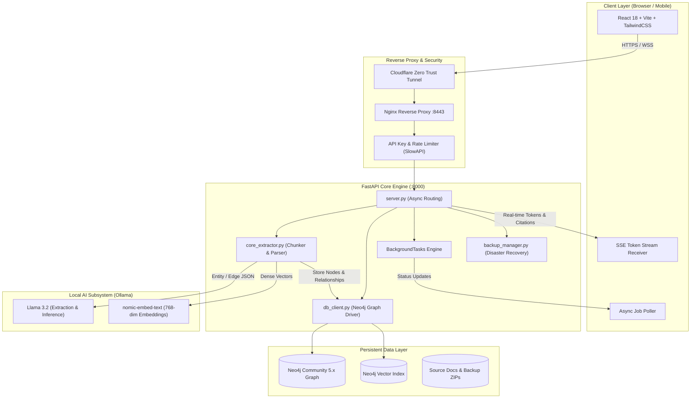

<div align="center">

# 🧠 GraphRAG Knowledge System
### *Autonomous Knowledge Graph Construction, Hybrid Vector-Graph Retrieval & Local Agentic AI*

[](https://neo4j.com/)
[](https://ollama.com/)
[](https://fastapi.tiangolo.com/)
[](https://react.dev/)
[](https://www.docker.com/)
[](LICENSE)

<p align="center">
  A state-of-the-art, <b>100% private, local-first GraphRAG</b> system. Combining dense vector semantic search with rich Neo4j knowledge graph traversals, real-time Server-Sent Events (SSE) streaming, isolated workspaces, background asynchronous document processing, automated disaster recovery, and a futuristic mobile-responsive interface.
</p>

---

### 🖥️ Application Showcase

<table>
  <tr>
    <td width="50%" align="center">
      <b>🌙 Dark Theme — Hybrid Graph Retrieval & SSE Streaming</b>
    </td>
    <td width="50%" align="center">
      <b>☀️ Light Theme — Mobile Responsive & Workspace Isolation</b>
    </td>
  </tr>
  <tr>
    <td width="50%" align="center">
      
    </td>
    <td width="50%" align="center">
      
    </td>
  </tr>
  <tr>
    <td width="50%" align="center">
      <sub><i>Sub-second streaming responses with live citations, grounding metadata, and dynamic graph stats.</i></sub>
    </td>
    <td width="50%" align="center">
      <sub><i>Seamless mobile touch navigation, adaptive dual-pane tabs, and multi-tenant workspace management.</i></sub>
    </td>
  </tr>
</table>

</div>

---

## 📖 Table of Contents
1. [Why GraphRAG? (The Core Problem)](#-why-graphrag-the-core-problem)
2. [How I Built This From Scratch (The Engineering Journey)](#-how-i-built-this-from-scratch-the-engineering-journey)
   - [Phase 1: Knowledge Graph Foundation & Dual Extraction](#phase-1-knowledge-graph-foundation--dual-extraction)
   - [Phase 2: Hybrid Graph Retrieval, Grounding & SSE Streaming](#phase-2-hybrid-graph-retrieval-grounding--sse-streaming)
   - [Phase 3: Workspaces & Asynchronous Ingestion Engine](#phase-3-workspaces--asynchronous-ingestion-engine)
   - [Phase 4: Hardening, Security & Disaster Recovery](#phase-4-hardening-security--disaster-recovery)
   - [Mobile Architecture & UI/UX Evolution](#mobile-architecture--uiux-evolution)
3. [System Architecture & Flow](#-system-architecture--flow)
4. [Tech Stack](#-tech-stack)
5. [Directory Structure](#-directory-structure)
6. [Getting Started (Step-by-Step Local Setup)](#-getting-started-step-by-step-local-setup)
7. [Production Deployment & Public Tunneling](#-production-deployment--public-tunneling)
8. [API Reference & Security](#-api-reference--security)
9. [Disaster Recovery & Backups](#-disaster-recovery--backups)

---

## ⚡ Why GraphRAG? (The Core Problem)

Standard vector-only RAG (Retrieval-Augmented Generation) has significant blind spots:
1. **The Multi-Hop Failure**: When asked *"How does Component A interact with Component C through Component B?"*, standard vector embeddings miss the chain of reasoning if A and C appear in separate documents.
2. **Context Fragmentation**: Vector search retrieves isolated snippets, losing the higher-level hierarchy and semantic relationships between concepts.
3. **Hallucination in Complex Domains**: Without explicit entity-relationship grounding, models often fabricate connections between adjacent keywords.

**Our Solution**: By augmenting local dense vector embeddings (`nomic-embed-text`) with a directed **Neo4j Property Graph** extracted by an LLM (`llama3.2`), we achieve **Hybrid Graph-Vector Retrieval**. Queries retrieve both semantic text chunks and multi-hop graph subgraphs, grounding every answer in verifiable relational facts.

---

## 🛠️ How I Built This From Scratch (The Engineering Journey)

Building this platform required solving complex distributed AI, database, and concurrency challenges across four distinct architectural phases:

```
┌─────────────────┐     ┌─────────────────┐     ┌─────────────────┐     ┌─────────────────┐
│     Phase 1     │ ──▶ │     Phase 2     │ ──▶ │     Phase 3     │ ──▶ │     Phase 4     │
│ Graph Foundation│     │ Hybrid Stream   │     │ Async Workspaces│     │ Security & DR   │
│ & Extraction    │     │ & Citations     │     │ & Job Polling   │     │ & Mobile Ready  │
└─────────────────┘     └─────────────────┘     └─────────────────┘     └─────────────────┘
```

### Phase 1: Knowledge Graph Foundation & Dual Extraction
- **The Challenge**: Turning arbitrary raw documents (PDF, DOCX, TXT, Markdown) into structured graph nodes and edges without expensive proprietary cloud APIs.
- **Implementation**:
  - Engineered an asynchronous file ingestion pipeline supporting PDF, text, and markdown files.
  - Built a sliding-window text chunker (1,000 characters with 150-character overlap) to preserve semantic boundaries.
  - Developed a structured schema prompt for `llama3.2` running on local **Ollama** that extracts JSON objects containing `entities` (`id`, `name`, `type`, `description`) and `relationships` (`source`, `target`, `type`, `description`).
  - In parallel, generated 768-dimensional dense vector embeddings using `nomic-embed-text`.
  - Implemented transactional Cypher queries in Neo4j using `MERGE` statements to guarantee idempotent node and edge creation without duplicates:
    ```cypher
    MERGE (e:Entity {id: $id, workspace_id: $workspace_id})
    SET e.name = $name, e.type = $type, e.description = $desc
    ```

### Phase 2: Hybrid Graph Retrieval, Grounding & SSE Streaming
- **The Challenge**: Retrieving context in under 1 second and streaming the answer to the user with zero latency and full citation transparency.
- **Implementation**:
  - **Hybrid Search Algorithm**:
    1. The user's query is embedded into a 768-dim vector.
    2. Neo4j performs a cosine similarity vector search across all indexed chunks to identify top seed nodes.
    3. Traverses 1-hop and 2-hop graph neighborhoods from those seed nodes to collect all connected entities and relationships.
  - **Context Synthesis**: Assembles retrieved entities, relationships, and raw text chunks into a unified grounded prompt.
  - **Real-Time Streaming**: Implemented **Server-Sent Events (SSE)** via FastAPI's `StreamingResponse`. The client receives tokens as they are generated by Ollama (`llama3.2`) in real time, followed by structured metadata events carrying citations and node statistics.

### Phase 3: Workspaces & Asynchronous Ingestion Engine
- **The Challenge**: Ingesting large 100-page documents can take minutes. Synchronous HTTP uploads would freeze the frontend or cause 504 Gateway Timeouts.
- **Implementation**:
  - **Multi-Tenant Workspaces**: Scoped every graph node, edge, and document to a `workspace_id`. Users can switch between isolated knowledge bases (e.g. `General`, `Research`, `Finance`) without data contamination.
  - **Background Job Engine**: Built a durable JSON-backed job state manager (`jobs_store.json`) integrated with FastAPI's `BackgroundTasks`.
  - **Polling Architecture**: Document uploads return immediately with a `job_id` and HTTP 202 status. The frontend polls `/api/jobs/{job_id}`, displaying live stage progress (`parsing` ➔ `extracting` ➔ `indexing` ➔ `completed`) and automatically updates the workspace entity counts upon completion.

### Phase 4: Hardening, Security & Disaster Recovery
- **The Challenge**: Preparing the local prototype for real-world deployment, public internet exposure, and server failures.
- **Implementation**:
  - **Zero-Trust Security & Rate Limiting**: Added header-based API Key authentication (`X-API-Key`) with dynamic environment fallbacks. Protected all endpoints against denial-of-service with `slowapi` sliding-window rate limiters.
  - **Automated Disaster Recovery**: Created `backup_manager.py`, capable of generating snapshot archives (full Cypher property graph export, uploaded source files, and workspace metadata) and restoring a fresh Neo4j database with zero data loss.
  - **Containerization**: Authored multi-stage production Docker configurations (`docker-compose.prod.yml`, `Dockerfile`, and Nginx reverse proxy configurations) for zero-downtime deployment.

### Mobile Architecture & UI/UX Evolution
- **The Challenge**: Complex dual-pane desktop layouts (Chat + Ingestion Sidebar) become unreadable and cramped on mobile touch screens.
- **Implementation**:
  - Designed an adaptive navigation system featuring top-level pill switches (`💬 AI Assistant` vs `📥 Ingest & Sources`) that activates on mobile breakpoints (`max-w-md`).
  - Switched height calculations to modern CSS `100dvh` (Dynamic Viewport Height) to eliminate mobile browser navigation bar clipping.
  - Implemented high-contrast dark/light mode theming with full custom SVG branding (`favicon.svg`) and browser tab title integration.

---

## 🏛️ System Architecture & Flow



---

## 💻 Tech Stack

| Component | Technology | Version | Purpose |
| :--- | :--- | :--- | :--- |
| **Backend Framework** | FastAPI / Starlette | `0.110+` | High-performance asynchronous API engine |
| **Graph Database** | Neo4j Community Edition | `5.x` | Graph node/edge topology & vector index |
| **Local LLM Engine** | Ollama | `0.1.30+` | Completely private local model inference |
| **LLM Reasoning** | Meta Llama 3.2 | `3B / 8B` | Entity-relationship extraction & grounded RAG |
| **Embeddings** | Nomic Embed Text | `v1.5 (768-d)` | Semantic document and query vectorization |
| **Frontend UI** | React, TypeScript, Vite | `React 18` | Ultra-fast client interface with Lucide icons |
| **Styling** | TailwindCSS | `3.4+` | Glassmorphic design with dark/light themes |
| **Async Tasks** | FastAPI BackgroundTasks | Built-in | Non-blocking document ingestion queue |
| **Security** | SlowAPI & Header Auth | `0.1.9` | Sliding-window rate limiting & API security |
| **Disaster Recovery** | Python `zipfile` + Cypher | Custom | Point-in-time graph and document restoration |
| **Public Tunneling** | Cloudflare Quick Tunnel | `cloudflared` | Zero-cost worldwide public exposure |

---

## 📁 Directory Structure

```
P05/
├── README.md                              # Comprehensive project documentation
├── start_system.bat                       # One-click launch script for all services
├── cloudflared.exe                        # Cloudflare Quick Tunnel binary
├── docs/
│   └── images/
│       ├── dark_mode.png                  # Fixed-size dark mode showcase
│       └── light_mode.png                 # Fixed-size light mode showcase
│
├── graphRAG_Knowledge_System/             # 🐍 Python FastAPI Backend
│   ├── server.py                          # Main API routes, SSE streaming & rate limits
│   ├── db_client.py                       # Neo4j connection, vector search & graph traversal
│   ├── core_extractor.py                  # Document parser, LLM entity extraction & chunking
│   ├── security.py                        # API key authentication & SlowAPI configuration
│   ├── backup_manager.py                  # Disaster recovery backup & restore logic
│   ├── requirements.txt                   # Python package dependencies
│   ├── Dockerfile                         # Backend container definition
│   ├── docker-compose.yml                 # Local Neo4j orchestration
│   ├── docker-compose.prod.yml            # Full production stack (Backend + Frontend + DB)
│   ├── deploy_vps.sh                      # Automated VPS deployment script
│   ├── .env                               # Environment configurations (Credentials & Ports)
│   ├── backups/                           # Snapshot backup storage directory
│   └── tests/                             # Automated test suites (Phase 1-4)
│
└── Design Futuristic Knowledge System/    # ⚛️ React 18 + Vite Frontend
    ├── src/
    │   ├── App.tsx                        # Core application layout & theme provider
    │   ├── components/                    # Modular UI components (Chat, Ingest, MobileTabs)
    │   └── ...                            # Custom hooks, API services & icons
    ├── public/
    │   └── favicon.svg                    # Custom geometric SVG branding icon
    ├── package.json                       # Node dependencies & scripts
    ├── vite.config.ts                     # Vite build configuration & proxy rules
    ├── Dockerfile                         # Production Nginx multi-stage build
    └── nginx.conf                         # Reverse proxy configuration
```

---

## 🚀 Getting Started (Step-by-Step Local Setup)

### 1. Prerequisites
Ensure the following tools are installed on your machine:
- **Git**
- **Docker Desktop** (running)
- **Python 3.10+**
- **Node.js 18+** & `npm`
- **Ollama** ([Download here](https://ollama.com/))

### 2. Prepare Local AI Models
Download the embedding and generation models locally:
```bash
ollama pull llama3.2
ollama pull nomic-embed-text
```

### 3. Launch Neo4j Graph Database
Start the containerized Neo4j database:
```bash
cd graphRAG_Knowledge_System
docker compose up -d
```
> Verify Neo4j is live at [http://localhost:7474](http://localhost:7474) (Username: `neo4j`, Password: `password123`).

### 4. Configure & Start Backend
Set up your virtual environment and launch FastAPI:
```bash
cd graphRAG_Knowledge_System

# Create and activate virtual environment
python -m venv .venv
# On Windows:
.venv\Scripts\activate
# On Linux/macOS:
source .venv/bin/activate

# Install dependencies
pip install -r requirements.txt

# Start backend server
python -m uvicorn server:app --host 0.0.0.0 --port 8000 --reload
```
> Swagger documentation is available at [http://localhost:8000/docs](http://localhost:8000/docs).

### 5. Configure & Start Frontend
```bash
cd "Design Futuristic Knowledge System"

# Install packages
npm install

# Start Vite development server
npm run dev
```
> Open your browser at [http://localhost:8443](http://localhost:8443).

---

## 🌐 Production Deployment & Public Tunneling

### Option A: Free Public Tunnel (Cloudflare Quick Tunnels)
To share your running local instance with any user in the world without opening router ports or paying for hosting:
```bash
# In the root P05 folder:
./cloudflared.exe tunnel --url http://localhost:8443
```
Cloudflare outputs a secure HTTPS link (e.g. `https://your-unique-name.trycloudflare.com`). Anyone worldwide can now test your GraphRAG platform directly!

### Option B: Full Production Docker Stack
To run the entire system (Frontend, Backend, Neo4j) fully containerized in production:
```bash
cd graphRAG_Knowledge_System
docker compose -f docker-compose.prod.yml up -d --build
```

---

## 🛡️ API Reference & Security

All API endpoints can be protected with the `X-API-Key` header. Requests without valid keys or exceeding rate limits receive standard HTTP error responses.

| Method | Endpoint | Description | Rate Limit |
| :--- | :--- | :--- | :--- |
| `POST` | `/api/chat/stream` | Hybrid Vector-Graph retrieval with real-time SSE stream | 30 / min |
| `POST` | `/api/ingest` | Asynchronous file ingestion (returns `job_id`) | 10 / min |
| `GET` | `/api/jobs/{job_id}` | Poll document processing progress | 60 / min |
| `GET` | `/api/workspaces` | List all available isolated workspaces | 60 / min |
| `POST` | `/api/workspaces` | Create a new isolated workspace | 20 / min |
| `GET` | `/api/graph/stats` | Retrieve node and relationship counts for workspace | 60 / min |
| `POST` | `/api/backups/create` | Trigger full system snapshot backup | 5 / min |
| `POST` | `/api/backups/restore` | Restore database and documents from backup file | 2 / min |

---

## 💾 Disaster Recovery & Backups

This platform includes a dedicated disaster recovery subsystem (`backup_manager.py`).

- **Create a Backup**:
  ```bash
  curl -X POST http://localhost:8000/api/backups/create -H "X-API-Key: your_key_here"
  ```
  Exports all nodes, relationships, embeddings, and raw files into a timestamped `.zip` archive inside `graphRAG_Knowledge_System/backups/`.

- **Restore from Backup**:
  ```bash
  curl -X POST "http://localhost:8000/api/backups/restore?filename=backup_20260906_165320.zip" -H "X-API-Key: your_key_here"
  ```
  Automatically resets the target workspace and re-populates Neo4j without needing manual Cypher scripting.

---

## 🤝 Contributing & License

Contributions, issues, and feature requests are welcome! Feel free to check the issues page.

This project is licensed under the **MIT License** — see the [LICENSE](LICENSE) file for details.

<div align="center">
  <b>Built with ❤️ for Local, Private & Scalable AI</b>
</div>
